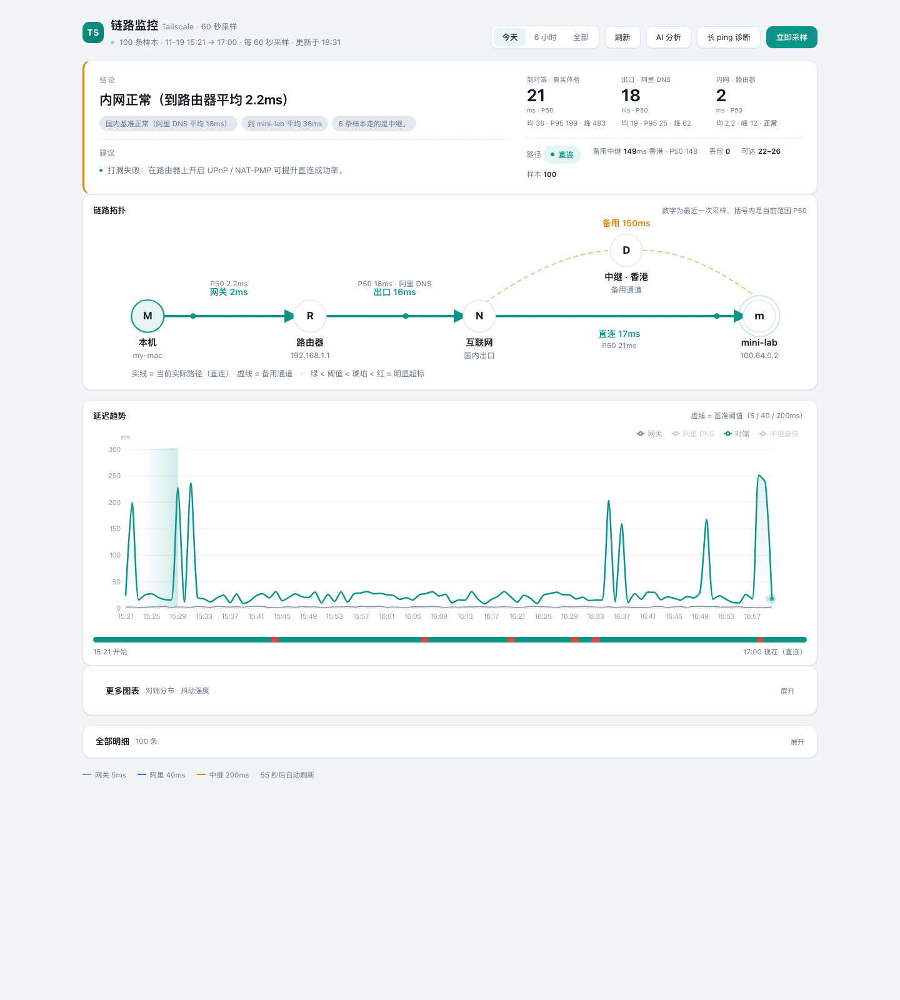
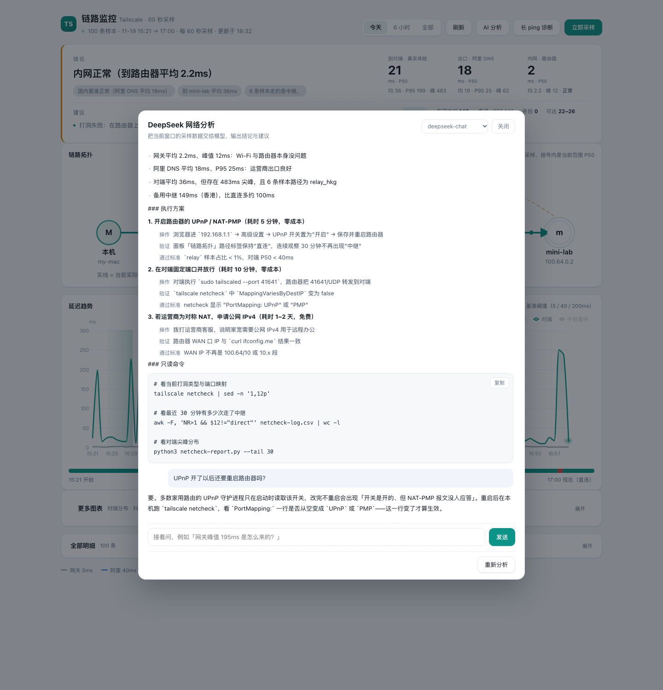

# Tailscale Watch

一个本地运行的 Tailscale / 家宽链路监控面板：每 60 秒采样一次，把「到路由器」「到国内出口」「到对端设备」三段延迟 + 「直连还是走中继」落成 CSV，再用一个网页把"到底哪一环慢"讲清楚。

给普通人看的，不是网工工具。面板只有四块，第一眼就是一句人话结论和三个大数字。



## 为什么会有这个

`tailscale status` 会告诉你 `relay "nue"`，`tailscale netcheck` 会给你二十几个 DERP 的延迟，`ping` 会给你一串数字——但你依然不知道**该改 Wi-Fi 还是该找运营商**。

这个项目的做法是把三段链路分开测，用同一套阈值判断：

| 测到哪里 | 说明什么 |
|---|---|
| 路由器网关 | Wi-Fi / 路由器本身稳不稳（内网底色） |
| 阿里 DNS `223.5.5.5` | 运营商出口到公网的质量（网速基准） |
| 对端 Tailscale 设备 | 你真实感受到的延迟（体验真相） |

三段一对比，问题基本就落位了：网关就抖 → 查 Wi-Fi；网关正常出口高 → 查 CPE / 找运营商；前两个都正常但对端慢 → 查打洞 / 中继。

## 特性

- **零依赖**：后端只用 Python 标准库；前端单文件 + 离线 ECharts，断网也能看
- **60 秒采样**：launchd 常驻，CSV 落盘，历史可回看
- **四块布局**：结论条 / 链路拓扑（带流动光点）/ 延迟趋势 / 折叠区，信息分层
- **长 ping 诊断**：三目标并行 40 包，直接给 min / avg / max / 抖动 / 丢包
- **AI 分析**：接 DeepSeek，输出「结论 / 依据 / 执行方案 / 只读命令」，方案具体到"点哪里、跑什么命令、通过标准是多少"，支持多轮追问，SSE 流式输出
- **隐私默认**：密钥只存本机（`chmod 600`）；日志、CSV、对话全部 gitignore

## 快速开始

要求：macOS 12+、Python 3.9+、已登录的 Tailscale。

```bash
git clone <repo> tailscale-watch
cd tailscale-watch

cp config.env.example config.env   # 填对端 Tailscale 地址（PEER_HOST）
make check                         # 语法自检
make sample                        # 采一条样本，生成 netcheck-log.csv
make run                           # 启动面板 http://127.0.0.1:8767
```

`config.env` 是本机私有配置（对端地址、显示名、基准目标），已在 `.gitignore` 中排除，仓库里只有示例文件。

想让它常驻（开机自启、每 60 秒采样）：

```bash
make install        # 安装两个 launchd 服务
make uninstall      # 卸载
```

也可以双击 `scripts/start-panel.command` / `scripts/stop-panel.command` 临时启停。

端口默认 **8767**，可用 `PANEL_PORT=9000 make run` 覆盖（改了端口记得同步 `.panel-port` 与 plist）。

## 配置

所有个性化项都在 `config.env`（从 `config.env.example` 复制）：

| 键 | 说明 | 示例 |
|---|---|---|
| `PEER_HOST` | 对端设备地址（Tailscale IP 或 MagicDNS 名） | `100.64.0.2` |
| `PEER_NAME` | 对端在界面上的显示名 | `mac-mini` |
| `SELF_NAME` | 本机显示名，留空则用系统 hostname | `my-mac` |
| `ALI_HOST` | 国内出口基准目标 | `223.5.5.5` |
| `GATEWAY_FALLBACK` | 采样拿不到网关时的兜底显示 | `192.168.1.1` |

同名环境变量优先级高于文件，便于临时覆盖。

## 界面怎么看

从上到下只有四块，越靠上越重要：

1. **结论条**：左边一句人话结论 + 补充标签 + 至多 3 条建议；右边三个大数字——对端 P50（真实体验）、出口 P50（网速基准）、网关 P50（内网底色）。看这三个数基本就够。
2. **链路拓扑**：本机 → 路由器 → 互联网 → 对端，实线为主路径、虚线为备用中继弧线；每段标最近一次延迟，颜色按阈值变色，光点沿线路流动。

3. **延迟趋势**：默认只画两条线（对端 + 网关），出口与中继在图例里灰着，点一下才出现；底部色带显示逐次"直连 / 中继"。
4. **折叠区**：「更多图表」（分布、抖动强度）、「全部明细」（逐条采样），默认收起。

### 判读口径

| 指标 | 正常 | 偏高 | 超标 |
|---|---|---|---|
| 网关平均 | < 5 ms | 5–10 ms | > 10 ms（内网不稳） |
| 阿里 DNS 平均 | < 40 ms | 40–100 ms | > 100 ms（出口拥塞） |
| 对端平均 | < 100 ms | 100–200 ms | > 200 ms |
| 中继最快 | < 200 ms | 200–400 ms | > 400 ms（偏远） |
| 中继可达数 | ≥ 20 | 15–19 | < 20（国际出口丢包） |
| 抖动（峰值/平均） | < 2× | 2–3× | > 3×（尖峰频繁） |

## 长 ping 诊断

点右上角「长 ping 诊断」，同时向路由器、阿里 DNS、对端各发 40 个包（0.3 秒间隔，约 12 秒），给出发包 / 丢包 / 最小 / 平均 / 最大 / 抖动（stddev）并自动判定。

平均值会被单个尖峰拉高，所以判定同时看抖动——抖动能直接看出链路稳不稳。

## AI 分析（可选）

点右上角「AI 分析」，第一次会让你**在页面里**粘贴一次 DeepSeek 密钥（`sk-…`）。密钥只写入本机 `app/.deepseek_key`（`chmod 600`），不经过任何中转；删除该文件即等于注销。

每次分析会把当前窗口的**摘要**（各项 P50/P95/平均/峰值、直连中继次数、抖动比、丢包条数、最差样本、最近 10 条明细、以及面板的判读口径）发给 DeepSeek，输出固定四段：

- **结论**：一句话
- **依据**：每条都带数字
- **执行方案**：编号 1/2/3，每条含「操作（点哪里 / 跑什么命令）· 验证 · 通过标准（数值门槛）」
- **只读命令**：可直接粘贴的 `sh` 代码块，不含 `sudo`、不改配置

出完可以继续追问，回答是流式的。



> 本文所有截图均来自**合成演示数据**（`docs/screenshots` 里的地址为占位值），不含任何真实网络信息。

> **隐私**：摘要会发到 DeepSeek 云端，包含延迟数字、设备名、内网 IP，不含任何流量内容。介意就别启用 AI 功能——其它功能完全离线。

## 项目结构

```
tailscale-watch/
├── app/
│   ├── server.py            面板后端（标准库 ThreadingHTTPServer）
│   ├── deepseek.py          AI 封装（密钥、流式、缓存）
│   ├── index.html           前端单文件
│   └── vendor/echarts.min.js
├── docs/
│   ├── DEVELOPMENT.md       开发提示词：可复刻整套系统的规格与踩坑清单
│   └── screenshots/
├── launchd/
│   ├── agent.plist.template 每 60 秒采样
│   └── panel.plist.template 面板常驻
├── scripts/
│   ├── start-panel.command  双击启动
│   ├── stop-panel.command   双击停止
│   ├── install-launchd.sh   安装常驻服务
│   └── uninstall-launchd.sh 卸载
├── config.env.example      配置模板（复制为 config.env）
├── netcheck-watch.sh        采样器（--once / --daemon / --bg / --stop）
├── netcheck-report.py       中文命令行报表（--today / --tail N）
├── Makefile
├── CHANGELOG.md
├── CONTRIBUTING.md
└── LICENSE (MIT)
```

## 数据格式

`netcheck-log.csv`，16 列，顺序固定：

```
time, nearest_derp, derp_fastest, derp_fastest_ms, derp_reachable,
ali_loss, ali_avg, ali_max, macmini_loss, macmini_avg, macmini_max,
path, gateway_loss, gateway_avg, gateway_max, gateway_ip
```

`path` 为 `direct` 或 `relay_<region>`；`gateway_ip` 由默认路由动态获取。CSV 属于个人网络数据，已在 `.gitignore` 中排除。

## 主要接口

```
GET  /api/samples        ?range=today|6h|all
GET  /api/summary        聚合统计 + 结论 + 建议
POST /api/sample         立即采样
POST /api/longping       启动长 ping（{"count":40}）
GET  /api/ai/status      密钥状态 + 对话历史
POST /api/ai/config      保存密钥 / 模型
POST /api/ai/analyze/stream   流式分析（SSE）
POST /api/ai/chat/stream      流式追问（SSE）
```

## 已知限制

- 只测「从本机看出去」的链路，不是设备间的全互联延迟矩阵
- DERP 列表来自 `tailscale netcheck`，面板本身不主动 ping 各区域
- 依赖 `ping` 的 ICMP：少数主机/防火墙不回 ICMP 时该项会显示不可达
- 目前只考虑 macOS（`/sbin/ping`、`route -n get default`、launchd）

## 参与贡献

见 [CONTRIBUTING.md](CONTRIBUTING.md)。提交前请跑 `make check`，并确保没有把 CSV、密钥、真实 IP 提交进仓库。

## License

[MIT](LICENSE) © 2026 huiziqin

---

## English (short)

A local dashboard for Tailscale/home-broadband link health. Samples every 60s (gateway / domestic DNS / peer latency + direct-vs-relay path) into a CSV, and renders a 4-block page: one-sentence verdict with three headline numbers, an animated topology, a two-line latency trend, and collapsed detail views. Optional DeepSeek integration produces actionable, step-by-step remediation with copyable read-only commands (streaming, multi-turn). Zero Python dependencies, single-file frontend, offline ECharts. macOS only. MIT licensed.
